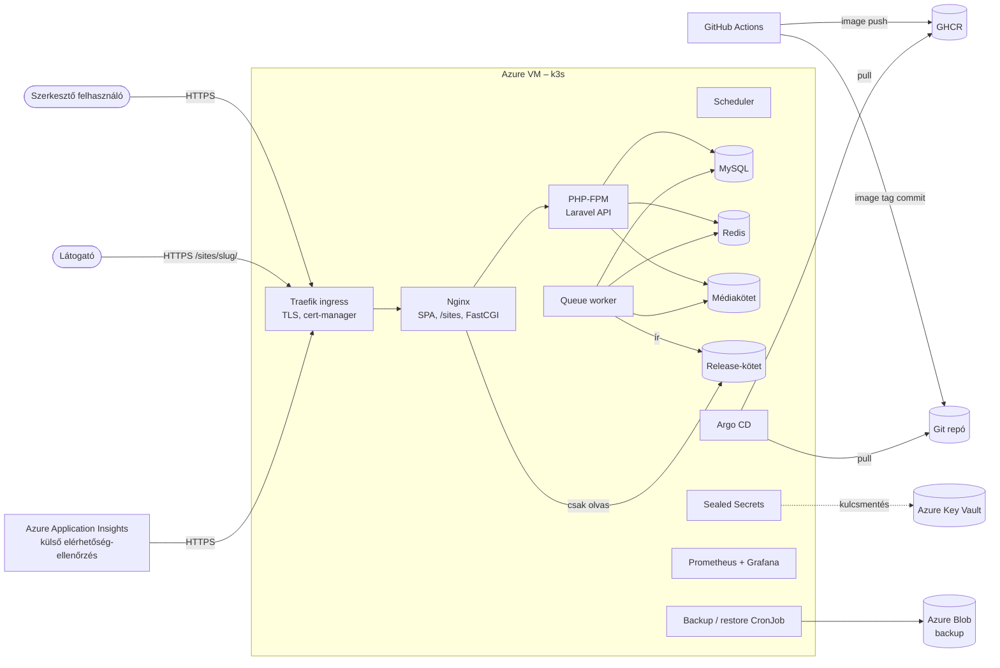

# Architektúra

## Cél és hatókör

A PageBuilder vizuális weboldalszerkesztő: a felhasználó webhelyeket és oldalakat hoz létre előre definiált komponensekből, majd aszinkron módon statikus HTML-ként publikálja őket. Egyetemi Cloud és DevOps beadandó; a reprodukálható technikai bizonyíték elsődleges a funkcionális komplexitással szemben.

## Rendszerkontextus

## Belépési pontok

| Belépési pont | Útvonal | Elérés |
|---|---|---|
| Szerkesztő SPA | `/` | nyilvános, hitelesítés után használható |
| REST API | `/api/v1/*` | Sanctum SPA cookie |
| Publikált webhelyek | `/sites/{slug}/` | nyilvános, statikus |
| Health | `/up` | nyilvános (csak állapot) |
| Metrikák | `/metrics` | csak clusteren belül |
| Grafana, Argo CD, Prometheus | — | csak `kubectl port-forward` |

## Perzisztens állapot

| Tároló | Tartalom | Mentés |
|---|---|---|
| MySQL | felhasználók, draft struktúra, deploymentek, pillanatképek | napi dump |
| Médiakötet | feltöltött eredeti fájlok (privát) | napi archívum |
| Release-kötet | publikált statikus verziók, `live/{slug}` symlinkek | napi archívum; tartalék: újragenerálás pillanatképből |
| Redis | session, queue, cache, alkalmazásmetrikák | nem mentett (perzisztencia: [roadmap](roadmap.md) nyitott kérdés) |

## Háttérfolyamatok

- **Queue worker:** publikálás és rollback ([publishing.md](publishing.md)).
- **Scheduler:** beragadt deploymentek felismerése, release-megőrzés, késleltetett médiatörlés.
- **CronJobok:** napi backup, heti restore-teszt ([devops.md](devops.md)).

## Környezetek

| Környezet | Futtatás | Cél |
|---|---|---|
| Lokális | Docker Compose | fejlesztés |
| CI | ideiglenes Compose-stack | Pest, Playwright, scanek |
| Production | Azure VM, k3s, Argo CD | éles üzem |

A staging opcionális; a `deploy/overlays/` szerkezet később bővíthető vele.

## Felhasználói folyamatok (MVP)

1. **Szerkesztés:** regisztráció → webhely és oldal → komponensek hozzáadása, sorrendezése, szerkesztése → mentés → előnézet.
2. **Sikeres publikálás:** `queued` → `running` → `succeeded`, a webhely elérhető, megjelenik az előzményekben.
3. **Sikertelen publikálás:** validációs hiba → `failed`, naplóval; az előző verzió élesben marad.
4. **Rollback:** korábbi sikeres deployment visszaállítása.

## MVP és opcionális funkciók

| MVP | Opcionális |
|---|---|
| Regisztráció, bejelentkezés, kijelentkezés | E-mail-megerősítés, jelszó-visszaállítás, 2FA, OAuth |
| Egy tulajdonos webhelyenként | Szerepkörök, megosztás, admin |
| 5 komponenstípus, korlátozott Markdown | WYSIWYG, egyedi HTML/CSS/JS, új típusok |
| Explicit mentés | Autosave |
| Webhelyszintű publikálás, előzmények, rollback | Draft visszaállítása pillanatképből |
| Útvonalalapú címzés, Azure DNS-név | Saját domain, aldomaines címzés |
| Lokális, CI, production | Staging |
| Prometheus, Grafana, JSON-napló | Loki, Alertmanager |
| Trivy, Gitleaks, audit, Dependabot | CodeQL, Snyk, OWASP Dependency-Check |
| Napi backup, restore-teszt, DR-gyakorlat | Velero, point-in-time restore |

## Döntésnapló

A döntések részletei a hivatkozott dokumentumban, az indoklás és az elvetett alternatívák az [AI auditban](ai-audit.md) találhatók.

| # | Döntés | Részletek | Audit |
|---|---|---|---|
| Q1 | Azure VM, k3s és Argo CD | [devops](devops.md) | AI-003 |
| Q2 | Azure for Students | [devops](devops.md) | AI-004 |
| Q3 | Release-kötet, atomi symlink-csere | [publishing](publishing.md) | AI-005 |
| Q4 | Címzés: `/sites/{slug}/` | [publishing](publishing.md) | AI-006 |
| Q5 | Publikálási egység: webhely | [publishing](publishing.md) | AI-007 |
| Q6 | Csak olvasható JSON-pillanatkép | [database-design](database-design.md) | AI-008 |
| Q7 | MySQL a clusterben | [devops](devops.md) | AI-009 |
| Q8 | GitOps ugyanebben a repóban | [devops](devops.md) | AI-010 |
| Q9 | Lokális, CI, production | [devops](devops.md) | AI-011 |
| Q10 | Média másolása a release-be | [publishing](publishing.md) | AI-012 |
| Q11 | Közös Blade renderer | [publishing](publishing.md) | AI-013 |
| Q12 | Egy tulajdonos | [security](security.md) | AI-014 |
| Q13 | Négy MVP folyamat | fent, [testing-strategy](testing-strategy.md) | AI-015 |
| Q14 | Metrikák és SLO-k | [devops](devops.md) | AI-016 |
| Q15 | Application Insights availability test | [devops](devops.md) | AI-017 |
| Q16 | k6 terheléses teszt | [testing-strategy](testing-strategy.md) | AI-018 |
| Q17 | CI biztonsági vizsgálatok | [security](security.md) | AI-019 |
| Q18 | Egy aktív deployment webhelyenként | [publishing](publishing.md) | AI-020 |
| Q19 | Rollback mint deployment | [publishing](publishing.md) | AI-021 |
| Q20 | Traefik, cert-manager, Nginx | [devops](devops.md) | AI-022 |
| Q21 | Azure DNS-név, LE staging → production | [devops](devops.md) | AI-023, AI-024 |
| Q22 | Privát média `X-Accel-Redirect`-tel | [api-design](api-design.md) | AI-025 |
| Q23 | Explicit mentés, optimista zárolás | [api-design](api-design.md) | AI-026 |
| Q24 | Sealed Secrets, Key Vault, OIDC | [security](security.md) | AI-027 |
| Q25 | Backup-szabályzat | [devops](devops.md) | AI-028 |
| Q26 | Hitelesítési hatókör | [security](security.md) | AI-029 |
| Q27 | Komponensmezők, registry | [database-design](database-design.md) | AI-030 |
| Q28 | Törölt céloldal kezelése | [database-design](database-design.md) | AI-031 |
