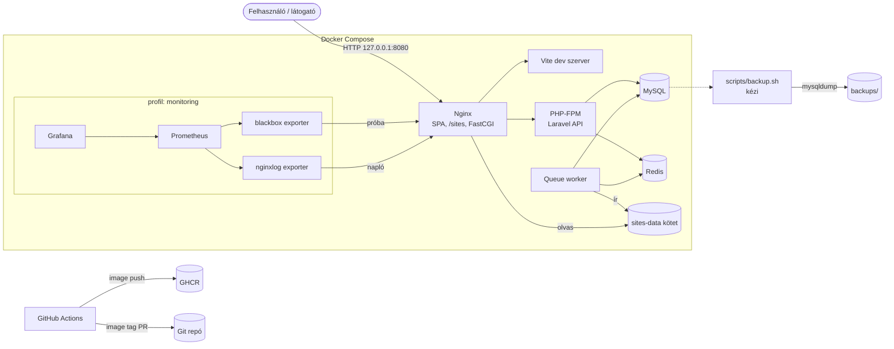
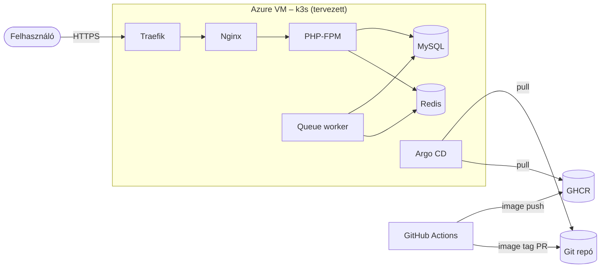

# Architektúra

## Cél és rendszerhatár

A PageBuilder vizuális weboldalszerkesztő: a felhasználó webhelyeket és oldalakat hoz létre három komponenstípusból (címsor, szöveg, gomb/link), majd queue jobbal statikus HTML-ként publikálja őket. Egyetemi Cloud és DevOps beadandó, MVP-hatókörrel ([roadmap](roadmap.md)); a halasztott elemek a [backlogban](backlog.md).

A rendszeren belül: SPA, Laravel API, queue worker, MySQL, Redis, publikált statikus fájlok, opcionális monitoring és kézi backup. Kívül: felhasználók, GitHub (repó, Actions, GHCR). Ténylegesen futó környezet a Docker Compose (lokális és CI); az Azure + k3s a **tervezett, nem telepített** célarchitektúra.

### Futó rendszer (Docker Compose)

### Tervezett célarchitektúra (nem telepített)

A `infra/` (Terraform) és a `deploy/` (manifestek, Argo CD `Application`) kész, de Azure-erőforrás nem jött létre, és a manifesteket k3s/kind clusteren nem futtattuk. A Traefik/Let's Encrypt, a clusterben futó monitoring, a backup CronJob és az Azure Blob nincs megvalósítva.

## Belépési pontok

| Belépési pont | Útvonal | Elérés |
|---|---|---|
| Szerkesztő SPA | `/` | nyilvános, hitelesítés után használható |
| REST API | `/api/v1/*` | Sanctum SPA cookie (CSRF: `/sanctum/csrf-cookie`); auth: `register`, `login`, `logout`, `user`; `websites` és `pages` (CRUD, csak a saját webhelyek; az oldal komponensei a `content` JSON-ban); `POST websites/{id}/publish` (202, queue job) |
| Publikált webhelyek | `/sites/{slug}/` | nyilvános, statikus |
| Health | `/up` | nyilvános |
| Grafana, Prometheus | — | opcionális `monitoring` profil, csak `127.0.0.1` (`GRAFANA_PORT`, `PROMETHEUS_PORT`) |

## Perzisztens állapot

| Tároló | Tartalom | Mentés |
|---|---|---|
| MySQL | felhasználók, webhelyek, oldalak (`content` JSON), publikálási állapot | kézi `scripts/backup.sh` (`backups/`), ütemezés nincs |
| Publikált oldalak | statikus HTML | újragenerálható |
| Redis | session, queue, cache | AOF, nem mentett |

## Környezetek

| Környezet | Futtatás |
|---|---|
| Lokális | Docker Compose |
| CI | GitHub Actions, ideiglenes Compose-stack |
| Production (terv) | Azure VM, k3s, Argo CD: a konfiguráció kész, de nincs kitelepítve; clusteres deploy és rollback nem bizonyított (T6.4/2 nyitott) |

## Döntésnapló

Az indoklás és az elvetett alternatívák az [AI auditban](ai-audit.md). A Q1–Q28 döntések egy része a bővített tervre vonatkozik; az MVP-ben a Q30 az irányadó.

| # | Döntés | Részletek | Audit |
|---|---|---|---|
| Q1 | Azure VM, k3s és Argo CD | [devops](devops.md) | AI-003 |
| Q2 | Azure for Students | [devops](devops.md) | AI-004 |
| Q3 | Release-kötet, atomi symlink-csere | [publishing](publishing.md) | AI-005 |
| Q4 | Címzés: `/sites/{slug}/` | [publishing](publishing.md) | AI-006 |
| Q5 | Publikálási egység: webhely | [publishing](publishing.md) | AI-007 |
| Q6 | Csak olvasható JSON-pillanatkép | [database-design](database-design.md) | AI-008 |
| Q7 | MySQL a clusterben | [devops](devops.md) | AI-009 |
| Q8 | GitOps ugyanebben a repóban | [devops](devops.md) | AI-010 |
| Q9 | Lokális, CI, production | [devops](devops.md) | AI-011 |
| Q10 | Média másolása a release-be | [publishing](publishing.md) | AI-012 |
| Q11 | Közös Blade renderer | [publishing](publishing.md) | AI-013 |
| Q12 | Egy tulajdonos | [security](security.md) | AI-014 |
| Q13 | Négy MVP folyamat | fent, [testing-strategy](testing-strategy.md) | AI-015 |
| Q14 | Metrikák és SLO-k | [devops](devops.md) | AI-016 |
| Q15 | Application Insights availability test | [devops](devops.md) | AI-017 |
| Q16 | k6 terheléses teszt | [testing-strategy](testing-strategy.md) | AI-018 |
| Q17 | CI biztonsági vizsgálatok | [security](security.md) | AI-019 |
| Q18 | Egy aktív deployment webhelyenként | [publishing](publishing.md) | AI-020 |
| Q19 | Rollback mint deployment | [publishing](publishing.md) | AI-021 |
| Q20 | Traefik, cert-manager, Nginx | [devops](devops.md) | AI-022 |
| Q21 | Azure DNS-név, LE staging → production | [devops](devops.md) | AI-023, AI-024 |
| Q22 | Privát média `X-Accel-Redirect`-tel | [api-design](api-design.md) | AI-025 |
| Q23 | Explicit mentés, optimista zárolás | [api-design](api-design.md) | AI-026 |
| Q24 | Sealed Secrets, Key Vault, OIDC | [security](security.md) | AI-027 |
| Q25 | Backup-szabályzat | [devops](devops.md) | AI-028 |
| Q26 | Hitelesítési hatókör | [security](security.md) | AI-029 |
| Q27 | Komponensmezők, registry | [database-design](database-design.md) | AI-030 |
| Q28 | Törölt céloldal kezelése | [database-design](database-design.md) | AI-031 |
| Q29 | Redis-perzisztencia (AOF), MySQL 9.7 LTS | [architecture](architecture.md), `compose.yaml` | AI-041 |
| Q30 | MVP-egyszerűsítés: JSON-komponensek, 3 típus, egyszerűsített publikálás, Traefik ACME, sima manifestek | [roadmap](roadmap.md), [backlog](backlog.md) | AI-044 |
| Q31 | Nincs Azure-kitelepítés: Terraform és `deploy/` megtartva; bizonyíték: Compose, CI, helyi backup és restore; a kind + Argo CD még nem bizonyított (T6.4/2) | [roadmap](roadmap.md) | AI-050 |
