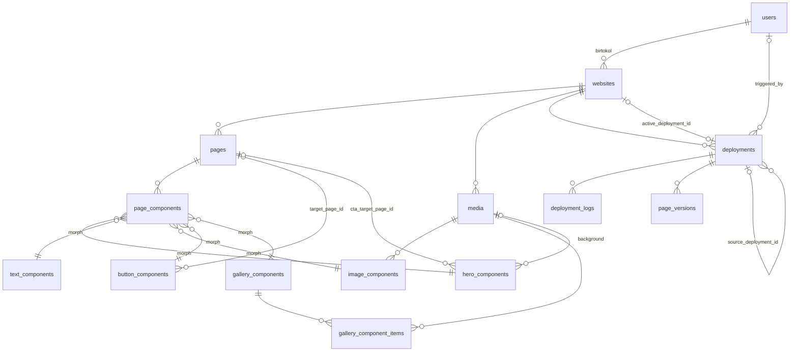

# Adatbázis-terv

> **Bővített terv** a beadandó utáni továbbfejlesztéshez; nem karbantartott. Az MVP-hatókör: [roadmap](roadmap.md), a halasztott elemek: [backlog](backlog.md).

MySQL 8, InnoDB, `utf8mb4`. A szerkeszthető (draft) struktúra relációs; a publikált állapot módosíthatatlan pillanatkép (`page_versions`).

## ER diagram

## Táblák

Minden táblában `id` (bigint PK) és – ahol nincs másképp jelölve – `created_at`, `updated_at`. A `?` NULL-t engedő oszlopot jelöl.

### Felhasználók és webhelyek

| Tábla | Oszlopok | Megszorítások, indexek |
|---|---|---|
| `users` | `name`, `email`, `password`, `remember_token?` | `email` egyedi |
| `websites` | `user_id`, `name`, `slug`, `active_deployment_id?` | `user_id` FK cascade; `slug` globálisan egyedi; `active_deployment_id` FK `deployments` null on delete (külön migrációban, körkörös FK) |
| `pages` | `website_id`, `title`, `slug`, `position`, `lock_version` (default 0) | `website_id` FK cascade; egyedi (`website_id`, `slug`); egyedi (`website_id`, `position`) |

A legkisebb `position` értékű oldal a webhely kezdőlapja (`index.html`).

### Komponensek

| Tábla | Oszlopok | Megszorítások, indexek |
|---|---|---|
| `page_components` | `page_id`, `component_type`, `component_id`, `position` | `page_id` FK cascade; egyedi (`page_id`, `position`); egyedi (`component_type`, `component_id`) |
| `hero_components` | `title`, `subtitle?`, `background_media_id?`, `alignment`, `cta_label?`, `cta_link_type?`, `cta_target_page_id?`, `cta_url?` | `background_media_id` FK restrict; `cta_target_page_id` FK null on delete |
| `text_components` | `heading?`, `body` | — |
| `image_components` | `media_id`, `alt`, `caption?`, `width` | `media_id` FK restrict |
| `button_components` | `label`, `link_type`, `target_page_id?`, `url?`, `style`, `open_in_new_tab` | `target_page_id` FK null on delete |
| `gallery_components` | `heading?`, `columns` | — |
| `gallery_component_items` | `gallery_component_id`, `media_id`, `alt`, `caption?`, `position` | `gallery_component_id` FK cascade; `media_id` FK restrict; egyedi (`gallery_component_id`, `position`) |

Felsorolt értékek (string oszlop, PHP backed enum): `alignment` = left/center; `width` = narrow/wide/full; `link_type` = internal/external; `style` = primary/secondary; `columns` = 2–4.

Maximális hosszok, a galéria maximális elemszáma és az alapértelmezett értékek a `config/components.php`-ben vannak, nem a sémában.

### Média

| Tábla | Oszlopok | Megszorítások, indexek |
|---|---|---|
| `media` | `website_id`, `storage_path`, `original_name`, `mime_type`, `size_bytes`, `width?`, `height?`, `checksum_sha256`, `deleted_at?` | `website_id` FK cascade; `storage_path` egyedi |

A `storage_path` szerveroldalon generált UUID-alapú relatív útvonal. A használatban lévő média törlése 409 (FK restrict). A törlés soft delete; a fizikai törlést ütemezett job végzi a backup-megőrzési idő után.

### Publikálás

| Tábla | Oszlopok | Megszorítások, indexek |
|---|---|---|
| `deployments` | `website_id`, `type` (publish/rollback), `status` (queued/running/succeeded/failed), `source_deployment_id?`, `triggered_by?`, `manifest_checksum?`, `error_message?`, `attempts`, `queued_at`, `started_at?`, `finished_at?` | `website_id` FK cascade; `source_deployment_id` FK `deployments` restrict; `triggered_by` FK `users` null on delete; index (`website_id`, `status`), (`website_id`, `created_at`) |
| `deployment_logs` | `deployment_id`, `level`, `message`, `context?` (JSON), `created_at` | `deployment_id` FK cascade; index (`deployment_id`, `created_at`) |
| `page_versions` | `deployment_id`, `page_id?`, `page_slug`, `page_title`, `position`, `snapshot` (JSON), `snapshot_checksum`, `created_at` | `deployment_id` FK cascade; `page_id` FK null on delete; egyedi (`deployment_id`, `page_slug`) |

`page_versions` csak publish típusú deploymenthez készül; a rollback a forrás-deployment verzióit használja. A sorok létrehozás után nem módosulnak (a modell `updating` eseménye kivételt dob).

### Laravel-infrastruktúra

`failed_jobs` (MySQL). Session, queue és cache Redisben; `sessions`, `jobs`, `cache` és `personal_access_tokens` tábla nem kell.

## Polimorf integritás

Az adatbázis nem véd a polimorf hivatkozásokon, ezért:

- `Relation::enforceMorphMap()` rövid aliasokkal (`hero`, `text`, `image`, `button`, `gallery`), a `config/components.php` registryből.
- A `component_type` validálása a registry alapján.
- A komponenssor és a `page_components` sor létrehozása és törlése egy tranzakcióban. Oldal vagy webhely törlésekor a komponenssorokat az alkalmazás törli ugyanabban a tranzakcióban (a DB cascade csak a `page_components` sort törölné).
- Egyedi (`component_type`, `component_id`): egy komponenssor pontosan egy oldalhoz tartozik.
- Integritásteszt: nincs árva komponenssor, és nincs nem létező komponensre mutató `page_components` sor.

## Pozíciók

A `position` egyedi megszorítás miatt az átrendezés két lépésben, egy tranzakcióban történik: először ideiglenes (negatív) értékek, majd a végleges 0..n-1 sorrend.

## Belső linkek és törölt céloldal

- A belső link `target_page_id` (illetve `cta_target_page_id`), amely ugyanahhoz a webhelyhez tartozó oldalra mutathat; ezt a backend validálja.
- Oldaltörlés előtt a felület figyelmeztet a hivatkozó komponensekre (`GET /api/v1/pages/{page}/references`).
- Törléskor az FK NULL-ra állítja a hivatkozást; `link_type = internal` és NULL cél esetén a link törött. A szerkesztő jelzi, a publikálás előtti validáció elbukik, amíg nincs javítva.
- A publikált verziókat a törlés nem érinti: a pillanatképben a linkek feloldott URL-ként szerepelnek.

## Draft és publikált tartalom

| | Draft | Publikált |
|---|---|---|
| Tárolás | relációs táblák | `page_versions.snapshot` JSON és a release-könyvtár |
| Módosítható | igen (`lock_version`) | nem |
| Forrás | szerkesztő | publish job a mentett draftból |

## Seederek

Fejlesztői seeder: egy demófelhasználó, egy webhely két oldallal, mind az öt komponenstípussal. Teszteléshez minden modellhez factory.
