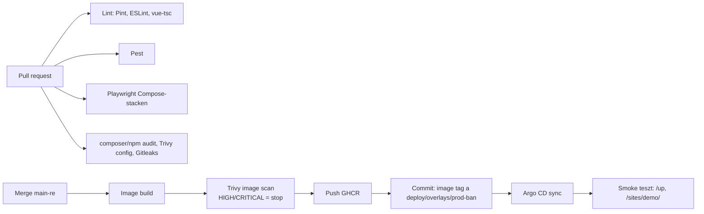

# DevOps

> A „Lokális környezet” szakasz aktuális; a többi **bővített terv** a beadandó utáni továbbfejlesztéshez, nem karbantartott. Az MVP-hatókör: [roadmap](roadmap.md), a halasztott elemek: [backlog](backlog.md).

## Repó-szerkezet

```
backend/    Laravel API (PHP-FPM image)
frontend/   Vue SPA (build az Nginx image-be)
e2e/        Playwright
load/       k6 szkriptek
docker/     Dockerfile-ok, Nginx-konfiguráció (lokális és éles közös alap)
deploy/     Kustomize: base/, overlays/prod/, platform komponensek (Argo CD Application-ök)
infra/      Terraform (bootstrap/, main/), Grafana dashboardok
docs/
```

## Lokális környezet (Docker Compose)

Szolgáltatások: `nginx`, `backend` (PHP-FPM), `worker`, `scheduler`, `mysql`, `redis`, `frontend` (Vite dev szerver). Mindegyiken healthcheck van, az indítás `service_healthy` feltétellel. A gépen csak Docker és Git kell. Rögzített image tagek, commitolt lock fájlok, `.env.example`.

- A hitelesítő adatok egyetlen forrása a gyökér `.env`; a backend `DB_*` változóit a Compose adja, és ezek elsőbbséget élveznek a `backend/.env`-vel szemben.
- Teszt-adatbázis: `<MYSQL_DATABASE>_testing`, külön, csak arra jogosult felhasználóval (`docker/mysql/init/`); a `phpunit.xml` `force="true"`-val a `mysql_testing` kapcsolatot, `array` sessiont és cache-t, `sync` queue-t ír elő.
- A backend healthcheckje a PHP-FPM `/ping` végpontja (`cgi-fcgi`).
- Nginx: egyetlen host port (`127.0.0.1:${NGINX_PORT:-8080}`); csak a `backend/public` van mountolva, így a `.env` és a többi backend-fájl nem érhető el HTTP-n; az `APP_URL`-t a Compose adja.
- A `DB_TEST_*` változók és a tesztfelhasználó csak a lokális és a CI-környezetben léteznek; az éles backend környezetébe nem kerülnek (a `mysql_testing` kapcsolat ott hitelesítő adat nélkül nem használható).

## Image-ek

| Image | Tartalom | Build |
|---|---|---|
| `ghcr.io/<owner>/pagebuilder-backend` | PHP-FPM, Laravel; a worker és a scheduler is ezt használja más paranccsal | multi-stage (Composer → runtime), nem root |
| `ghcr.io/<owner>/pagebuilder-nginx` | Nginx és a SPA buildje | multi-stage (Node build → Nginx), nem root |

Tag: commit SHA; release esetén SemVer is.

## CI/CD



- Az actionök commit SHA-ra rögzítettek, a `permissions` minimális (alapból `contents: read`; a tag-commit job `contents: write`, a push `packages: write`).
- A tag-commit nem indít újabb buildet (a `deploy/**` útvonal kizárva).
- A scan-eredmények CI-artifactként elérhetők; SARIF-feltöltés, ha az előfizetés támogatja.
- Kivétel (pl. `.trivyignore`) csak indoklással, jóváhagyással és lejárati dátummal ([security.md](security.md)).

## GitOps, deploy és rollback

- Az Argo CD a `deploy/overlays/prod` könyvtárat szinkronizálja (automated sync, self-heal, prune).
- Alkalmazás-rollback: a tag-commit `git revert`-je; az Argo CD visszaállítja az előző image-et. Minden deploy és rollback commitként visszakereshető.
- A webhely-tartalom rollbackje alkalmazásszintű ([publishing.md](publishing.md)), ettől független.

## Infrastruktúra (Terraform, Azure)

| Stack | Erőforrások |
|---|---|
| `infra/bootstrap` | resource group és storage account a Terraform state-hez (zárolással); Key Vault; backup storage account (lifecycle: 7 napi, 4 heti); `prevent_destroy` |
| `infra/main` | VNet, NSG (80/443 nyitva, SSH csak megadott IP-ről, a k3s API zárva), statikus publikus IP DNS-címkével, VM (2 vCPU, 4 GB, cloud-init: k3s), Log Analytics és Application Insights availability test |

- Az Azure-hitelesítés OIDC-vel (federated credential) történik. A `plan` a CI-ban fut, az `apply` jóváhagyás után.
- A hosztnév és a régió változó, nincs hardcode-olva.
- A Key Vault és a backup-tároló életciklusa független a VM-étől és a clusterétől.
- Költség: a VM leállítható (deallocate), amikor nincs használatban.

## Platformkomponensek a clusterben

Argo CD, Sealed Secrets, cert-manager (ClusterIssuer: Let's Encrypt staging, majd production), kube-prometheus-stack (Alertmanager nélkül), mysqld-exporter, redis-exporter, blackbox exporter. Mindegyik deklaratívan, rögzített chartverzióval, erőforráskorlátokkal.

## TLS

- Hosztnév: `<label>.<region>.cloudapp.azure.com`.
- Előbb Let's Encrypt staginggel teszteljük, siker után production. HTTP→HTTPS átirányítás.
- Ismert kockázat: a közös `azure.com` limit miatt az első igénylés elbukhat (AI-024). Ilyenkor újrapróbálás, végső esetben DuckDNS.
- A Laravel `TrustProxies` csak a cluster belső hálózatát fogadja el.

## Megfigyelhetőség

**Metrikaforrások:** Traefik (HTTP), Laravel `/metrics` (`promphp/prometheus_client_php`, Redis tároló, csak clusteren belül), node-exporter, kube-state-metrics, mysqld- és redis-exporter, backup- és restore-metrikák.

**Szabályok:** nincs magas kardinalitású címke (`user_id`, `website_id`); rövid megőrzés (pl. 7 nap); erőforráskorlátok. Ha a 4 GB RAM kevés, egyszerűsített stack jön (Prometheus és Grafana operator nélkül).

**Dashboardok:** JSON-ként verziózva (`infra/grafana/`), provisioninggel betöltve.

**Elérhetőség:** belül blackbox exporter, kívül Application Insights Standard test (API `/up` és egy publikált oldal).

**Naplózás:** JSON a stdout-ra (Laravel `stderr` csatorna JSON formatterrel, Nginx JSON access log). A Loki opcionális.

### SLI és SLO

| SLI | SLO (30 nap, hosszú távú cél) | Forrás |
|---|---|---|
| API-rendelkezésre állás (nem 5xx arány) | ≥ 99% | Traefik |
| API-latencia p95 | < 500 ms | Traefik |
| Publikált oldalak rendelkezésre állása | ≥ 99,5% | Traefik, Application Insights |
| Publikálás sikeraránya (validációs hiba nélkül) | ≥ 95% | `/metrics` |
| Publikálási idő p95 (queue-várakozással) | < 60 s | `/metrics` |

A beadandóban rövidebb ablakban, reprodukálható k6 terheléssel demonstráljuk ([testing-strategy.md](testing-strategy.md)). A 30 napos SLO teljesülését elegendő mérési adat nélkül nem állítjuk.

## Titokkezelés

Sealed Secrets (titkosítva a gitben). A controller kulcsa az Azure Key Vaultban van, amely a Terraform state-ben nem tárol titokértéket. A CI-titkok GitHub Secrets-ben vannak; GHCR-hez `GITHUB_TOKEN`. Visszaállítás és rotáció: `docs/runbooks/` (T8.3 feladat).

## Backup és restore

| Elem | Érték |
|---|---|
| Tartalom | MySQL dump (`--single-transaction`), médiakötet, release-kötet; manifest és SHA-256 |
| Ütemezés | napi CronJob; a mentés idejére a publikálás felfüggesztve (lock) a konzisztencia érdekében |
| Cél | külön Azure storage account, titkosított tárolás, HTTPS |
| Megőrzés | 7 napi és 4 heti (lifecycle policy) |
| Jogosultság | a backup csak írhat, a restore csak olvashat |
| Restore-teszt | heti CronJob izolált ideiglenes MySQL-be; checksum- és integritás-ellenőrzés |
| Metrikák | `backup_last_success_timestamp`, `restore_test_last_success_timestamp`; a mentés elmaradása látható a dashboardon |
| Cél | RPO ≤ 24 óra, RTO ≤ 2 óra |

### Disaster recovery

Forgatókönyv: a VM elvész. Lépések: `terraform apply` (main) → k3s → a Sealed Secrets kulcsának visszaállítása a Key Vaultból → Argo CD bootstrap → szinkron → restore a legutóbbi backupból → ellenőrzés. Tartalék: release-újragenerálás pillanatképből. Egy ténylegesen végrehajtott gyakorlat mért RPO- és RTO-értékekkel kerül dokumentálásra.
