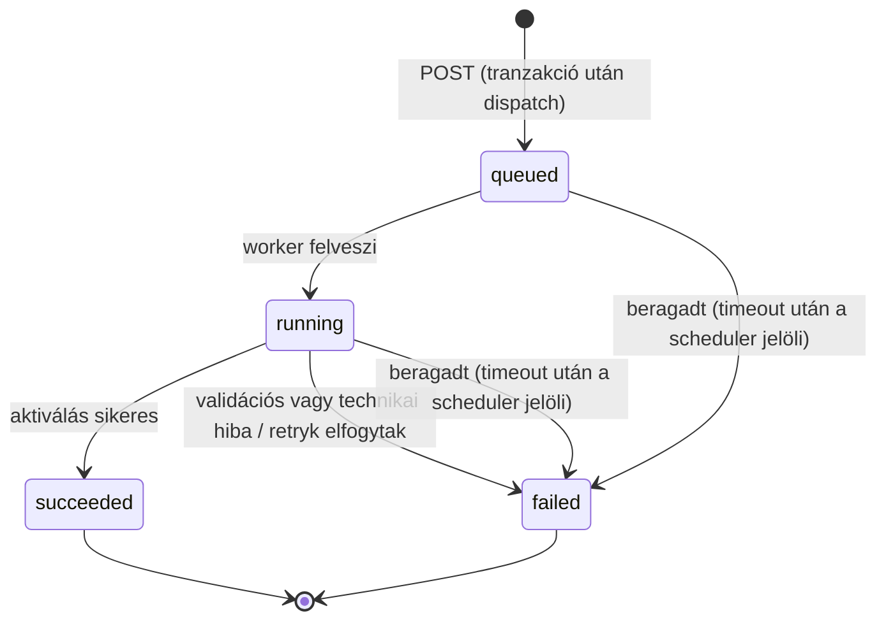

# Publikálás

Aszinkron, webhelyszintű, atomi aktiválással. A publikálás és a rollback ugyanazt az állapotgépet, lockot és jobot használja.

## Állapotgép



## Konkurencia

- Webhelyenként legfeljebb egy `queued` vagy `running` deployment. A létrehozás tranzakcióban, a `websites` sor `SELECT … FOR UPDATE` zárolásával ellenőriz; ütközéskor 409.
- A job a tranzakció commitja után kerül a queue-ba (`afterCommit`).
- Kiegészítő védelem: `ShouldBeUnique` és `WithoutOverlapping`, kulcs: `website_id`.
- Különböző webhelyek párhuzamosan publikálhatók.

## Könyvtárszerkezet

```
/var/www/published/
  releases/{website_id}/{deployment_id}/   # módosíthatatlan release
    index.html, {page_slug}/index.html, assets/, media/, manifest.json
  tmp/{deployment_id}/                     # építés alatt
  live/{slug} -> ../releases/{website_id}/{deployment_id}
```

Az Nginx a `/sites/{slug}/` útvonalat a `live/{slug}` symlinkre képezi, csak olvasható mounttal. A worker írja a kötetet.

## Publish job lépései

1. **Validálás:** a mentett draft; kötelező mezők, törött belső linkek, hiányzó média, üres webhely. Hiba esetén `failed`, felhasználónak szóló napló; nincs retry.
2. **Pillanatkép:** oldalanként `page_versions` sor (JSON, feloldott URL-ekkel, checksummal) egy tranzakcióban.
3. **Renderelés:** a közös Blade rendererrel a `tmp/{deployment_id}/` könyvtárba; relatív útvonalak.
4. **Média:** a felhasznált fájlok bemásolása (`media/`).
5. **Manifest:** `manifest.json`, amely minden fájlhoz SHA-256 checksumot tartalmaz; a checksum a `deployments.manifest_checksum` mezőbe kerül.
6. **Lezárás:** `tmp` → `releases/{website_id}/{deployment_id}` (rename).
7. **Aktiválás:** manifest-ellenőrzés, majd új symlink ideiglenes néven és `rename` a `live/{slug}` helyére (atomi).
8. **Rögzítés:** tranzakcióban `active_deployment_id` és `succeeded`.

Bármely hiba a 7. lépés előtt az éles verziót érintetlenül hagyja.

## Idempotencia és retry

- A job csak a `deployment_id`-t kapja.
- Újrafuttatáskor: a `tmp` könyvtár törlődik. Ha a release-könyvtár létezik **és** a manifest-ellenőrzés sikeres, a job onnan folytatja (6–8. lépés); különben újraépít.
- Ha a symlink már az adott release-re mutat, a 7. lépés kimarad, a 8. lefut.
- A timeout, a `tries` és a `backoff` konfigurálható. Technikai hibánál retry, validációs hibánál nincs.
- A beragadt deploymenteket (`queued` vagy `running` a konfigurált időkorláton túl) a scheduler `failed`-re állítja, naplóbejegyzéssel.

## Rollback

- Új `deployments` sor: `type = rollback`, `source_deployment_id` = az adott webhely egy `succeeded` deploymentje; rollback típusú cél esetén annak eredeti publish forrása.
- Lépések: a forrás-release manifest-ellenőrzése → ha hiányzik vagy sérült, újragenerálás a forrás `page_versions` pillanatképeiből → atomi symlink-csere → rögzítés.
- Sikertelen rollbacknél az aktuális éles verzió marad. A draft nem változik.

## Megőrzés

Webhelyenként az utolsó N (alapértelmezés 10, konfigurálható) sikeres release-könyvtár marad. Soha nem törlődik az aktív release, egy futó deployment forrása, és amire épp rollback készül. A `page_versions` sorok megmaradnak.

## Naplók és metrikák

- `deployment_logs`: lépésenként info, warning és error bejegyzés; a felületen megjelenik.
- Metrikák (alacsony kardinalitás, `website_id` címke nélkül): `pagebuilder_deployments_total{type,status}`, `pagebuilder_deployment_duration_seconds{type}` (a `queued_at`-tól a `finished_at`-ig, tehát a queue-várakozással együtt), queue-hossz.

## Előnézet

Ugyanaz a renderer a mentett draftból, fájlírás nélkül; a média a privát `/api/v1/media/{id}/file` végponton keresztül jelenik meg.
